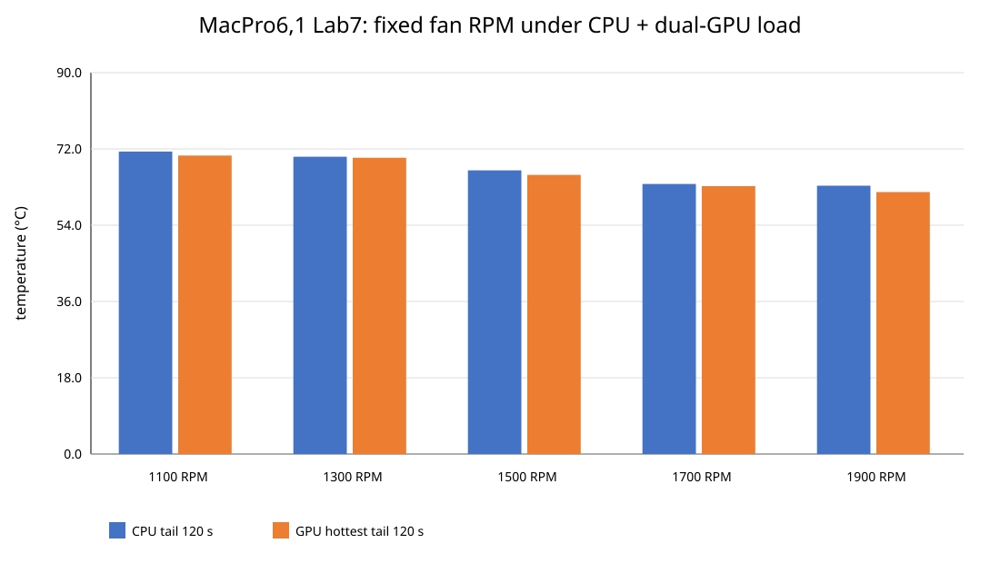

# MacPro6,1 thermal identification under sustained CPU + dual-GPU load

**Status:** Completed thermal-identification experiment

**Date:** 2026-10-10

## Summary

During the MacPro6,1 Local LLM research project, thermal behavior and
main-fan response emerged as a separate operational problem.

The earlier Linux kernel A/B benchmark used a fixed Vulkan0 reference
configuration. The thermal experiment reported here is different: it
deliberately exercised the CPU and both Vulkan devices simultaneously.

The purpose of this study was to characterize temperature response and
fan behavior before designing a production adaptive fan controller.

## Platform and workload

The experiment was performed on MacPro6,1 systems running Debian 13.

The thermal workload combined:

- CPU stress
- Vulkan0 workload
- Vulkan1 workload
- simultaneous CPU + dual-GPU operation
- Apple SMC telemetry
- main-fan RPM telemetry
- CPU and GPU temperature monitoring

The experiment used Linux `6.12.112-labtest`.

## SMC AUTO observation

On Lab7, during the approximately five-minute loaded portion of the
AUTO phase, the main fan remained near approximately 790 RPM.

Observed values included:

- CPU maximum: approximately 75 °C
- hottest GPU maximum: approximately 74 °C
- terminal CPU slope: +2.464 °C/min
- terminal hottest-GPU slope: +1.932 °C/min

The positive terminal slopes indicate that thermal equilibrium had not
been reached by the end of this observation window.

This does not establish that Apple SMC AUTO control never raises fan
speed. Other tests in this project have observed an AUTO fan increase
under hotter or longer workloads.

The narrower finding is that the tested AUTO response did not reach
thermal equilibrium within this specific workload window.

## Fixed-RPM identification

The experiment tested manual fan targets of:

- 1100 RPM
- 1300 RPM
- 1500 RPM
- 1700 RPM
- 1900 RPM

At 1100 RPM on Lab7, terminal temperature slopes remained positive:

- CPU: +0.810 °C/min
- hottest GPU: +0.712 °C/min

Therefore 1100 RPM must not be generalized as a safe continuous
operating point.

The 1500-1700 RPM region appears useful for further controller design,
but a production fan curve has not yet been finalized.

## Dynamic response

A dynamic sequence was also tested:

`1100 -> 1500 -> 1900 -> 1500 -> 1100 -> 1900 RPM`

This allowed heating and cooling response to be observed while the
workload continued.

The long-term objective is an adaptive controller rather than one fixed
fan speed.

## Limitations

These results apply only to the tested machines, ambient conditions,
kernel, workload, and observation periods.

They do not establish that:

- every MacPro6,1 behaves identically;
- Apple SMC firmware is defective;
- Debian 13 always provides insufficient cooling;
- 1100 RPM is safe for sustained use;
- 1500-1700 RPM is already a validated production curve.

## Previous publication

This study follows the earlier kernel-performance investigation:

[Kernel-dependent Vulkan op-offload performance — 2026-10-03](../../docs/findings/kernel-vulkan-op-offload-20261003.md)

## Relationship to the Local LLM study

The thermal problem was discovered during the wider effort to use
MacPro6,1 systems as Local LLM nodes.

The kernel-performance and thermal-control studies are kept separate
because their workloads answer different questions.

They are expected to converge in future work. A practical Local LLM
node must sustain useful inference performance while also maintaining
CPU and GPU temperatures safely over long periods.

Future experiments will therefore evaluate Local LLM throughput,
dual-GPU utilization, Linux kernel behavior, temperature, fan control,
thermal throttling, and sustained performance together under the same
controlled workload.

## Data

Processed thermal data used for this report are available under:

`data/`
